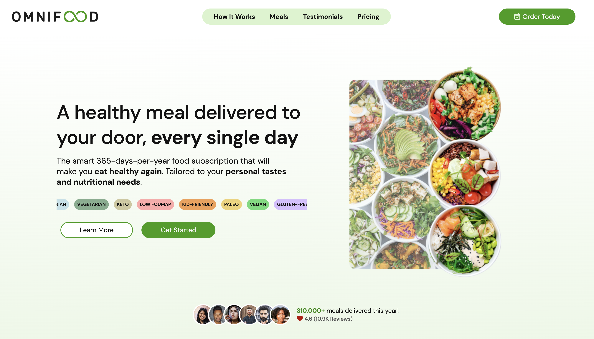

# Omnifood

A landing page for Omnifood, a fictional AI-powered meal subscription service. It's my redesign of the Omnifood project from Jonas Schmedtmann's *Build Responsive Real-World Websites with HTML and CSS* course, with my own color scheme and styling.

**[Live site](https://omnifood.aniqa.dev)**

<a href="https://omnifood.aniqa.dev"></a>

## Tech

- HTML and JavaScript
- CSS written in Sass, split into partials for each section and breakpoint
- Font Awesome icons and Google Fonts (DM Sans and DM Serif Text)

## Features

- Sections for how it works, meals, testimonials and a photo gallery, two pricing plans and a sign-up form, plus press logos
- Sticky navigation that appears once you scroll past the hero, with smooth scrolling to each section
- A hamburger menu on tablets and phones that locks page scrolling while it's open
- A monthly or annual pricing toggle
- A sign-up form with validation and a reply that admits there's no free meal to send, since the company isn't real

## Design

- The original course assets restyled with my own palette
- The app screenshots in "How it works" animate as they scroll into view, and a marquee of diets (paleo, vegan, gluten-free and more) drifts across the hero
- Eight breakpoints from 25em to 83em, so the layout holds up from small phones to wide desktops

## Accessibility

- Every image has alt text, and icon-only social links have labels
- Semantic heading levels throughout

## Project structure

- `public/index.html`: the page
- `public/script/index.js`: menu, sticky header, scroll animations, pricing toggle and form
- `src/`: Sass source, split into `base/`, `sections/` and `queries/`, compiled to `public/styles/main.css`
- `public/assets/`: images, compressed in 2023

## Key concepts

- **IntersectionObserver** for two jobs: watching the hero to make the header sticky, and animating the app screenshots as they enter the screen.
- **Sass partials** keep each section and breakpoint in its own file instead of one long stylesheet.
- **Cross-browser testing.** Vendor prefixes cover properties like `backdrop-filter`, and the `select` dropdown needed custom styling because every browser draws it differently.

## Setup

No API keys. Install Sass, compile the styles, then serve the `public/` folder:

```bash
git clone https://github.com/aniqatc/omnifood.git
cd omnifood
npm install
npx sass src/main.scss public/styles/main.css --watch
```

In another terminal, run `npx serve public` (or any local server pointed at `public/`).

## Changelog

### November 2023

- Moved styles into Sass partials and reorganized the folders for deployment
- The mobile menu now locks scrolling while open, and fixed a horizontal scrollbar

### September 2023

- Compressed and resized the largest images

### December 2022

- Initial release
